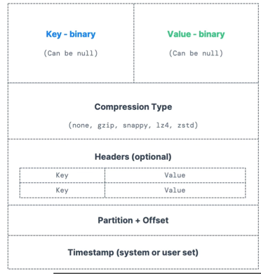
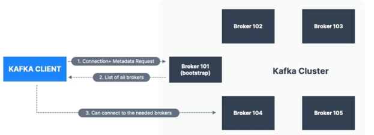

# Kafka Basics

## Problem and Solution
### Problem 
- Tight coupling: services call each other directly using HTTP.
  - If one service is down, the other service also be affected.
- Sychronous Execution: Services executes in linear fashion, step by step.
  - long running service will block the execution of other services.
- Loss of data: If one service is down, data received will be lost. 
- Example: Order -> Payment -> Inventory -> Shipping

### Solution
- Use Kafka as a messaging system to decouple services. 
- enable asynchronous communication.
- Example:
  - Order -> Kafka Topic -> Payment
  - Payment -> Kafka Topic -> Inventory
  - Inventory -> Kafka Topic -> Shipping
- No need to wait for response.
- Fire and forget Model.

### Core Concepts
- Event: A record of something that happened in the system.
  - Example: Generates an events when user places an order, payment is made, inventory is updated, shipping is initiated.
- Producer: Sends events to Kafka.
- Topics: A category/feed name to which records are published.
- Partition: Topics splits into partitions for scalability.
- Offset: Unique identifier for each message inside partition. 
  - Generated sequencially, Not be reused.
  - eg: Partition 0: offset 0,1,2,3,4 etc
  - Order is guaranteed only within partition (Not across partitions)
- Event stream: A sequence of related events.

### Consumer: Reads events from Kafka.
- Consumer: Reads events from Kafka topic. Data read in low to high offset order within each partition.
- Consumer Group: A group of consumers that work together to read events from a topic.
  - Create multiple consumer groups to read same topic in parallel (separated using property - group.id)
- Consumer Offset: A pointer to the last read event in a partition. Consumers can commit their offsets to Kafka to keep track of their progress.
  - __consumer_offsets : A special internal topic that stores the committed offsets for each consumer group.
  - If consumer dies, it can resume reading from the last committed offset.
- Delivery Semantics: Stratergy to Delivery of messages to consumers(Default: at-least-once)
  - At-lease-once: A message is delivered to a consumer at least once. (Default)
    - Offsets are commited after message is processed. 
    - If processing goes wrong, message will be read again and processed again.
    - This can lead to duplicate processing of messages. Make sure processing is idempotent.
  - At-most-once: A message is delivered to a consumer at most once.
    - Offsets are commited as soon as message is read.
    - If processing goes wrong, message will be lost and not processed again.
  - Exactly-once: A message is delivered to a consumer exactly once.
    - Kafka to kafka: Use Kafka Streams API to process messages and commit offsets atomically.

### Kafka Message: A message is a record of data that is sent to a Kafka topic.
  - A message consists of a key, value, and metadata (such as timestamp and headers).
  - messages are immutable and stored for limited time (Default: 1 week)

- Message Key: A key that decides which partition a message should be sent to.
  - If no key / key = null : Kafka will use round-robin to distribute messages across partitions.
- Message Value: The actual data that is being sent in the message.
- Compression Type: The algorithm used to compress the message data before sending it to Kafka.
  - Types: none, gzip, snappy, lz4, zstd | default: none
- Header: Optional metadata that can be included with a message, such as a content type or custom attributes.
- Partition + Offset: The partition and offset of a message, which uniquely identifies it within a topic.

- Serializer and deserializer: Kafka accepts and sends out data in Byte format, Thus data need to be serialized and deserialized.
  - Both key and value will be serialized and deserialized.
  - Data type should not change during serialization and deserialization. If required, create new topic.

- Kafka key hashing:
  - Process to determine the mapping of key to partition.
  - In default kafka uses murmur2 hashing algorithm to hash.
  - Formula: partition = hash(key) % number_of_partitions
  - targetPartition = Maths.abs(Utils.murmur2(keyBytes)) % ( numPartitions - 1 )

### Kafka Broker
- Kafka Broker (Bootstrap Server): A Kafka server that stores and serves messages to consumers.
- Kafka Cluster: A group of Kafka brokers that work together to provide high availability and scalability.
- Kafka broker discovery: When a producer or consumer connects to a kafka cluster, it discovers the available brokers.
  - Need to connect only broker and kafka client will discover other brokers in the cluster.
  - Each broker knows about all brokers in the cluster, topics and partitions.

### Topic Replication
- Replication Factor: The number of copies of a topic's partitions that are stored across different brokers in the cluster.
- Leader Partition: The partition that is responsible for handling all read and write requests for a given partition. Each partition has one leader and zero or more followers.
- Follower Partition: A partition that replicates the data from the leader partition. Followers do not handle read or write requests, but they can take over as the leader if the current leader fails.
  - Kafka prodcuer can only write to the leader partition.
  - Kafka consumer by default reads from leader partition. But can be configured to read from follower partition as well.
- ISR (In-Sync Replicas): The set of replicas that are fully caught up with the leader partition and are eligible to become the leader if the current leader fails.
  - Unclean Leader Election: A situation where a follower that is not fully caught up with the leader is elected as the new leader. This can lead to data loss and is generally avoided in production environments.

### producer acknowledgment
- acks = 0 
  - Prodcuer will not wait for any acknowledgment from the broker.
- acks = 1
  - Producer will wait for acknowledgment from the leader partition only.
- acks = all / -1
  - Producer will wait for acknowledgment from leader partition and all in-sync replicas (ISRs) before considering the message as successfully sent.

### Zookeeper
- Zookeeper in distributed coordination service that helps manage and coordinate distributed systems. It provides a centralized service for maintaining configuration information, naming, providing distributed synchronization, and group services.
- Post kafka 2.8, zookeeper is no longer required for kafka cluster management. Kafka has its own built-in consensus mechanism called KRaft (Kafka Raft) that replaces the need for zookeeper.
- Kafka 4.0 will remove zookeeper support completely.

- Event Stream: A sequence of events that are related to each other.
- Event-Driven Architecture: A software architecture pattern that uses events to trigger and communicate between decoupled services. 

