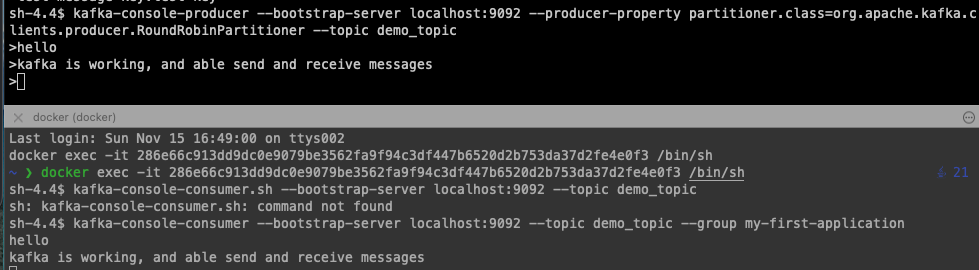

### CLI commands
```
kafka-topics --bootstrap-server localhost:9092 --list 
kafka-topics --bootstrap-server localhost:9092 --topic demo_topic --create --partitions 3 --replication-factor 2
kafka-topics --bootstrap-server localhost:9092 --topic demo_topic --describe

# Send message
kafka-console-producer --bootstrap-server localhost:9092 --topic demo_topic

# --producer-

# Send message with key
kafka-console-producer --bootstrap-server localhost:9092 --topic demo_topic --property "parse.key=true" --property "key.separator=:"
#Sample message
test-key:test-message

# Check msg received

```

## Test producer and receiver - connect from docker container
```aiignore
# start one producer and start producing
kafka-console-producer --bootstrap-server localhost:9092 --producer-property partitioner.class=org.apache.kafka.clients.producer.RoundRobinPartitioner --topic demo_topic

# start another consumer part of the same group. See messages being spread
kafka-console-consumer --bootstrap-server localhost:9092 --topic demo_topic --group my-first-application

```



# Consumer group
```aiignore
kafka-consumer-groups --bootstrap-server localhost:9092 --list

kafka-consumer-groups --bootstrap-server localhost:9092 --describe --group my-first-application
```

# Reset Offset
- --reset-offsets : it will reset offset to 0 in partition, so now if we start consumer then it will read all messages from beginning
```
# describe the consumer group
kafka-consumer-groups.sh --bootstrap-server localhost:9092 --describe --group my-first-application

# Dry Run: reset the offsets to the beginning of each partition
kafka-consumer-groups.sh --bootstrap-server localhost:9092 --group my-first-application --reset-offsets --to-earliest --topic third_topic --dry-run

# execute flag is needed
kafka-consumer-groups.sh --bootstrap-server localhost:9092 --group my-first-application --reset-offsets --to-earliest --topic third_topic --execute

# describe the consumer group again
kafka-consumer-groups.sh --bootstrap-server localhost:9092 --describe --group my-first-application

# consume from where the offsets have been reset
kafka-console-consumer.sh --bootstrap-server localhost:9092 --topic third_topic --group my-first-application

```
